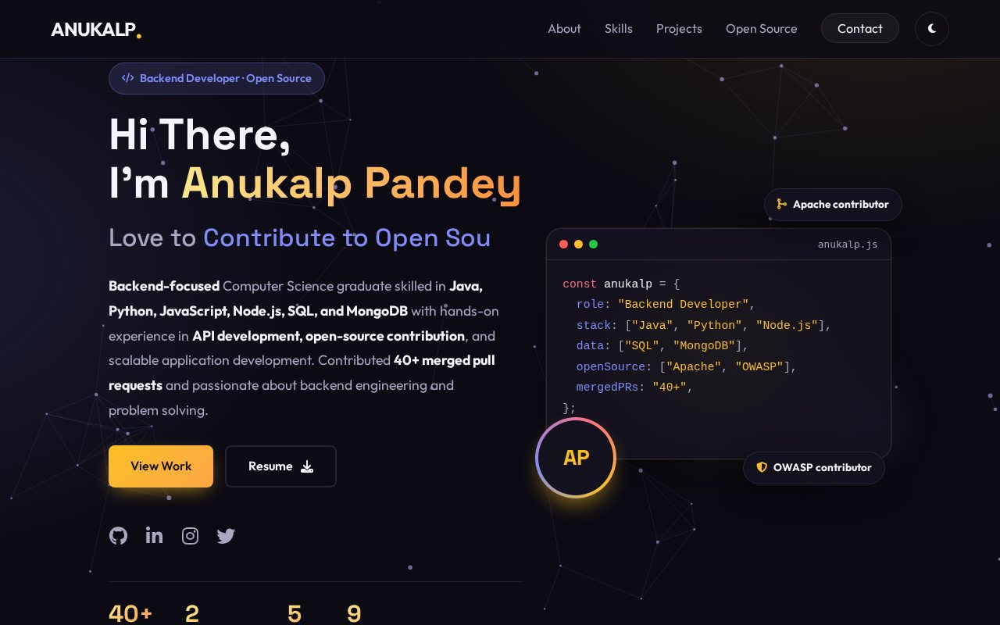
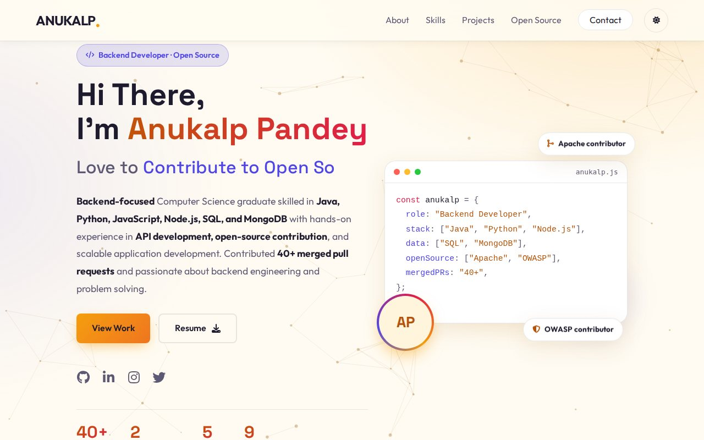
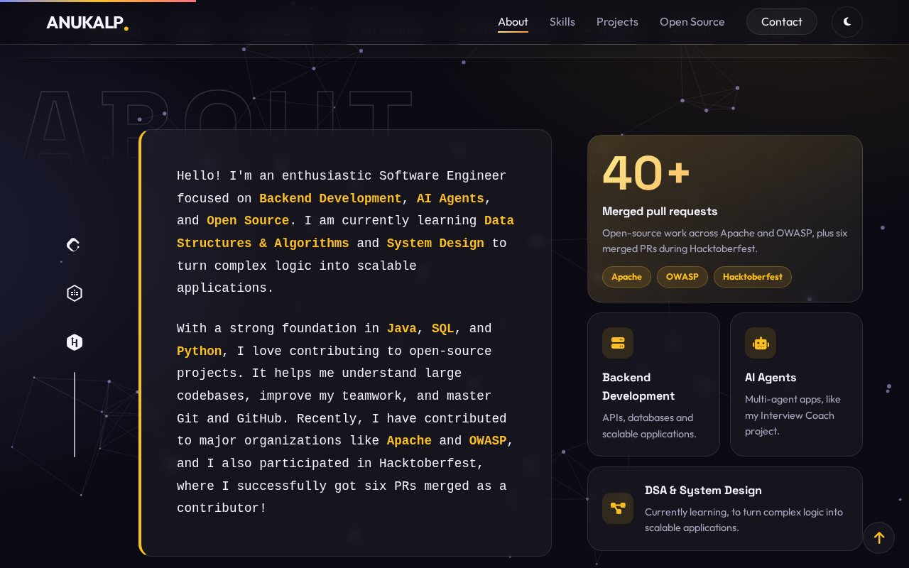
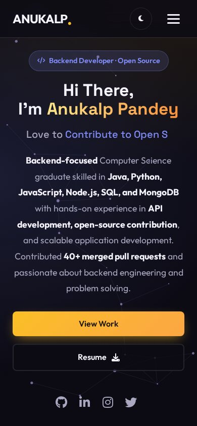

# Anukalp Pandey — Portfolio

A fast, responsive and accessible personal portfolio built with plain **HTML, CSS and JavaScript** — no framework and no build step.
It has dark and light themes, four colour palettes, dedicated pages for open-source contributions (Apache, OWASP),
a contact form, optional private visitor statistics and a strict Content-Security-Policy.

**Live site:** https://YOUR-DOMAIN &nbsp;·&nbsp; **Licence:** [MIT](LICENSE) (code only, see [NOTICE.md](NOTICE.md))

<table>
  <tr>
    <td width="50%"></td>
    <td width="50%"></td>
  </tr>
  <tr>
    <td align="center">Light theme</td>
    <td align="center">About section</td>
  </tr>
</table>

<!-- These are previews generated without the photo and project images, so the avatar shows initials.
     Replace the files in docs/screenshots/ with your own once your content is in place. -->

## Contents

- [Features](#features)
- [Tech stack](#tech-stack)
- [Quick start](#quick-start)
- [Customise it](#customise-it)
- [Project structure](#project-structure)
- [Deploy](#deploy)
- [Before you publish](#before-you-publish)
- [Security and privacy](#security-and-privacy)
- [Browser support and testing](#browser-support-and-testing)
- [Licence](#licence)

## Features

**Design**
- Dark and light theme. The first visit follows the visitor's system setting, and the choice is remembered. No flash of the wrong theme.
- Four switchable colour palettes (`gold` by default, `violet`, `emerald`, `rose`), each with a light and a dark version.
- Hero with a typing line, a code-editor card that describes the author, an avatar that falls back to initials if the photo is missing, count-up statistics and a scrolling technology strip.
- Responsive from 320 px phones to 1920 px screens. Animations respect the "reduce motion" setting.

**Content sections**
- **About** with a focus-areas grid, **Skills and Certifications** (each opens an accessible dialog), a **Projects** carousel, an **Open source** section and a **Contact** form.
- **Apache** and **OWASP** contribution pages: tabs with live counts, search, and cards generated from plain `.txt` files, so updating them means adding a line to a text file.

**Quality**
- Accessible: skip link, keyboard-friendly menu, dialogs and tabs, labelled controls, visible focus, good contrast (measured for all palettes).
- Fast: no framework, self-hosted fonts and icons, lazy-loaded images, one small script per page.
- SEO basics: meta description, Open Graph tags, JSON-LD profile data, `robots.txt` and a custom `404.html`.
- Secure by default: strict Content-Security-Policy, no third-party code, no inline scripts, safe rendering of all data, security headers file, a pre-publish checker that scans for secrets and mistakes.
- Optional, private visitor statistics (GoatCounter: no cookies, only you can see the numbers).

## Tech stack

| Layer | What is used |
|---|---|
| Markup, styling, behaviour | HTML5, CSS3 (custom properties, `color-mix()`), vanilla JavaScript (ES2017+) |
| Icons and fonts | Font Awesome Free 6.4.0, Outfit, Space Grotesk — all hosted in `vendor/` |
| Contact form | [Web3Forms](https://web3forms.com) (no backend needed) |
| Visitor statistics (optional) | [GoatCounter](https://www.goatcounter.com) |
| Tooling | One Python 3 script (`check-before-publish.py`), no packages to install |

## Licence

- The **source code** is released under the [MIT licence](LICENSE).
- The **personal content** (texts, photos, resume, certificates, project descriptions and screenshots, the `Data/` lists) is © 2026 Anukalp Pandey, all rights reserved. See [NOTICE.md](NOTICE.md).
- Third-party components (Font Awesome Free, Outfit, Space Grotesk) keep their own licences, listed in [NOTICE.md](NOTICE.md) and inside `vendor/`.
- Apache and OWASP are trademarks of their owners; this site is not affiliated with them.
